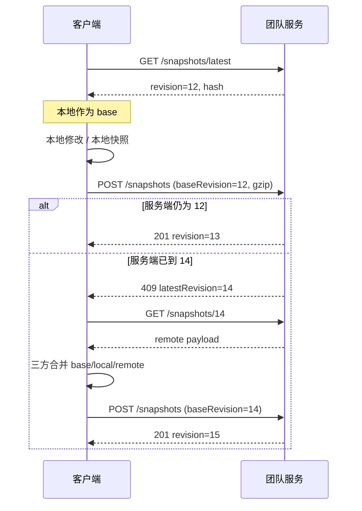

# Inkline 团队服务端接口方案

> 状态：设计稿　|　适用版本：桌面端 0.1.20+　|　接口前缀：`/v1`

## 1. 目标与边界

### 目标

- 让多个成员在不同机器上共享同一份集合、请求与文档草稿。
- 复用客户端现有的「本地快照 + 三方合并」模型，客户端改动最小。
- 适配内网私有部署：可离线、可自托管、TLS、审计留痕。
- 为后续细粒度协作（单请求协作、评论、在线状态）预留扩展点。

### 非目标（本期不做）

- 实时协同编辑（OT / CRDT）。
- 公网多租户 SaaS、计费。
- 把 AI 网关、Mock 服务托管到团队服务。
- 环境变量中的密钥跨机同步（默认不同步）。

## 2. 现状与约束

客户端当前同步模型（`apps/desktop/src/lib/team.ts`）：

- `push`：把全部请求与文档草稿打包成 `TeamSnapshot`，覆盖写入本机快照，`revision + 1`。
- `pull`：读取本机快照并作为 base，供三方合并使用。
- 合并：客户端已有 base / local / remote 三方合并与字段级冲突解决。
- 没有服务端，没有身份校验，快照只在一台机器上。

因此服务端第一阶段采用**整包快照同步 + 乐观锁**，而不是细粒度 CRUD：

- 优点：与现有客户端一致，冲突完全复用现有三方合并；离线可用。
- 代价：每次上传整包。通过 gzip、大小限制与后续增量优化控制成本。

## 3. 总体架构

```
┌────────────┐    HTTPS/JSON    ┌──────────────┐      ┌────────────┐
│ Inkline 桌面 │ ───────────────▶ │ 团队 API 服务  │ ───▶ │ PostgreSQL │
│  (Tauri)    │ ◀─────────────── │  (v1)        │      └────────────┘
└────────────┘                  │              │      ┌────────────┐
      │                         │              │ ───▶ │ 对象存储(可选) │
      │ 本机 SQLite / 快照        └──────────────┘      └────────────┘
      ▼
  本地工作区
```

- 桌面端仍以本地 SQLite 为主，团队服务只负责同步与身份。
- 服务端建议：Node 22 + Fastify + PostgreSQL 16；若希望与桌面端同栈，可用 Rust + axum + sqlx，接口不变。
- 快照较小时直接存 `bytea/jsonb`；超过阈值（如 2 MB）转存对象存储，接口返回下载地址。

## 4. 身份与权限

### 身份

- 账号：`account`（工号 / 内网邮箱），密码使用 Argon2id 哈希。
- 访问令牌：JWT，15 分钟有效；刷新令牌 30 天，旋转式刷新。
- 预留企业 SSO：`POST /v1/auth/oidc/exchange`，用 OIDC code 换取同一套令牌。
- 桌面端令牌必须存操作系统凭据库（Tauri keyring），**不得写入 localStorage**。

### 角色

| 角色 | 查看 | push / pull | 邀请成员 | 管理成员 | 团队设置 | 审计 |
| --- | --- | --- | --- | --- | --- | --- |
| `owner` | ✓ | ✓ | ✓ | ✓ | ✓ | ✓ |
| `admin` | ✓ | ✓ | ✓ | ✓ |  | ✓ |
| `member` | ✓ | ✓ |  |  |  |  |
| `viewer`（预留） | ✓ | pull |  |  |  |  |

一个团队至少保留一名 `owner`。

## 5. 数据模型

```sql
users (
  id uuid primary key,
  account citext unique not null,
  display_name text not null,
  password_hash text not null,
  disabled_at timestamptz,
  created_at timestamptz not null default now()
);

teams (
  id uuid primary key,
  name text not null,
  current_revision bigint not null default 0,
  created_by uuid not null references users(id),
  created_at timestamptz not null default now()
);

memberships (
  team_id uuid references teams(id) on delete cascade,
  user_id uuid references users(id) on delete cascade,
  role text not null check (role in ('owner','admin','member','viewer')),
  joined_at timestamptz not null default now(),
  primary key (team_id, user_id)
);

invites (
  code text primary key,
  team_id uuid references teams(id) on delete cascade,
  role text not null,
  created_by uuid not null,
  expires_at timestamptz not null,
  used_at timestamptz,
  used_by uuid
);

snapshots (
  team_id uuid references teams(id) on delete cascade,
  revision bigint not null,
  payload jsonb,               -- 小快照；大快照存对象存储时为 null
  object_key text,             -- 对象存储 key
  payload_hash text not null,  -- SHA-256(未压缩 payload)
  size_bytes bigint not null,
  schema_version int not null,
  base_revision bigint,
  created_by uuid not null,
  created_at timestamptz not null default now(),
  idempotency_key text,
  primary key (team_id, revision),
  unique (team_id, idempotency_key)
);

audit_logs (
  id bigserial primary key,
  team_id uuid,
  actor_id uuid,
  type text not null,          -- sync / member / auth / team
  action text not null,
  detail jsonb not null default '{}',
  request_id text,
  at timestamptz not null default now()
);

refresh_tokens (
  id uuid primary key,
  user_id uuid not null,
  token_hash text not null,
  expires_at timestamptz not null,
  revoked_at timestamptz,
  created_at timestamptz not null default now()
);
```

### 快照 Payload（schemaVersion 2）

```json
{
  "schemaVersion": 2,
  "collections": [{ "id": "col-1", "name": "订单服务", "sort": 0, "updatedAt": "..." }],
  "requests": [
    {
      "id": "req-1",
      "name": "创建订单",
      "method": "POST",
      "url": "{{host}}/api/orders",
      "headers": [{ "name": "Content-Type", "value": "application/json" }],
      "body": "{\"sku\":\"A100\"}",
      "dataLevel": "L1",
      "collectionId": "col-1",
      "sort": 0,
      "updatedAt": "..."
    }
  ],
  "documents": { "req-1": [{ "key": "请求:amount", "path": "amount", "type": "integer", "source": "请求", "description": "订单金额，单位分", "updatedAt": "..." }] }
}
```

说明：

- 服务端忽略客户端传来的 `revision`、`workspace`，以服务端团队与版本号为准。
- 现有客户端快照未包含 collections，schemaVersion 2 必须补上，否则跨机拉取后请求会失去所属集合。
- 环境变量默认不同步；若后续需要，只同步变量名与非敏感值，token 等一律不同步。
- 删除通过整包差异自然表达，服务端不做合并。

## 6. 接口规范

### 6.1 通用约定

- Base URL：`https://<team-host>/v1`
- 内容类型：`application/json; charset=utf-8`；快照支持 `Content-Encoding: gzip`
- 认证：`Authorization: Bearer <accessToken>`
- 客户端标识：`X-Inkline-Client: desktop/0.1.20`
- 请求追踪：`X-Request-Id`（服务端回填，便于排障）
- 时间：ISO 8601 UTC
- 错误统一格式：

```json
{
  "error": {
    "code": "revision_conflict",
    "message": "远端已有更新版本",
    "details": { "latestRevision": 12, "latestHash": "sha256:..." }
  },
  "requestId": "req_01H..."
}
```

通用错误码：

| code | HTTP | 说明 |
| --- | --- | --- |
| `unauthorized` | 401 | 缺少或过期令牌 |
| `forbidden` | 403 | 无团队权限 |
| `not_found` | 404 | 资源不存在 |
| `validation_failed` | 422 | 字段校验失败 |
| `payload_too_large` | 413 | 超过大小限制 |
| `rate_limited` | 429 | 频率限制 |
| `revision_conflict` | 409 | 版本冲突，需要先拉取合并 |
| `internal_error` | 500 | 服务端错误 |

### 6.2 认证

#### POST /v1/auth/login

```json
{ "account": "zhangsan", "password": "••••••" }
```

`200`：

```json
{
  "accessToken": "eyJ...",
  "expiresIn": 900,
  "refreshToken": "rt_...",
  "user": { "id": "u1", "account": "zhangsan", "displayName": "张三" }
}
```

#### POST /v1/auth/refresh

```json
{ "refreshToken": "rt_..." }
```

`200` 返回新的 accessToken + 旋转后的 refreshToken。

#### POST /v1/auth/logout

携带 refreshToken，服务端撤销该刷新令牌，`204`。

#### GET /v1/me

返回当前用户与所属团队列表（含角色）。

### 6.3 团队与成员

#### GET /v1/teams

`200`：

```json
{
  "teams": [
    { "id": "t1", "name": "支付中台", "role": "owner", "revision": 12, "memberCount": 5 }
  ]
}
```

#### POST /v1/teams

```json
{ "name": "支付中台" }
```

创建者自动成为 `owner`；`201` 返回团队与 `inviteCode`（可单独再生成）。

#### GET /v1/teams/{teamId}

返回团队基本信息、当前 revision、角色、成员数。

#### PATCH /v1/teams/{teamId}

```json
{ "name": "订单中台" }
```

仅 `owner`。

#### GET /v1/teams/{teamId}/members

```json
{
  "members": [
    { "userId": "u1", "account": "zhangsan", "displayName": "张三", "role": "owner", "joinedAt": "..." }
  ]
}
```

#### PATCH /v1/teams/{teamId}/members/{userId}

```json
{ "role": "admin" }
```

#### DELETE /v1/teams/{teamId}/members/{userId}

删除成员；不能移除最后一名 `owner`。

#### POST /v1/teams/{teamId}/invites

```json
{ "role": "member", "expiresInHours": 72 }
```

`201`：

```json
{ "code": "INK-7F3K-92QD", "expiresAt": "2026-11-14T08:00:00Z" }
```

#### POST /v1/team-invites/{code}/accept

当前用户加入团队，`200` 返回团队与角色。

### 6.4 快照同步（核心）

#### GET /v1/teams/{teamId}/snapshots/latest

`200`（有快照）：

```json
{
  "revision": 12,
  "hash": "sha256:9f2c...",
  "sizeBytes": 184320,
  "schemaVersion": 2,
  "createdBy": { "userId": "u1", "displayName": "张三" },
  "createdAt": "2026-11-11T08:00:00Z",
  "downloadUrl": "/v1/teams/t1/snapshots/12"
}
```

`204`：团队尚无快照。

参数：

- `inline=1`：小快照（≤ 512 KB）直接内联返回 `payload`，省一次请求。
- 客户端拉取后应把 `revision` 作为本地 `baseRevision` 保存。

#### GET /v1/teams/{teamId}/snapshots/{revision}

返回快照 Payload（`application/json`，可 gzip）。

#### POST /v1/teams/{teamId}/snapshots

提交新快照。请求头：

| Header | 必填 | 说明 |
| --- | --- | --- |
| `Idempotency-Key` | 是 | 客户端生成的 UUID；同一 key + 相同 hash 重试直接返回上次结果 |
| `Content-Encoding` | 否 | `gzip` |
| `X-Inkline-Base-Revision` | 是 | 本地最后一次同步的 revision；首次为 `0` |

请求体：

```json
{
  "schemaVersion": 2,
  "baseRevision": 12,
  "collections": [],
  "requests": [],
  "documents": {}
}
```

`201`：

```json
{ "revision": 13, "hash": "sha256:...", "createdAt": "..." }
```

`409`（版本冲突）：

```json
{
  "error": {
    "code": "revision_conflict",
    "message": "远端已有更新版本",
    "details": { "latestRevision": 14, "latestHash": "sha256:..." }
  }
}
```

#### GET /v1/teams/{teamId}/snapshots?limit=20&before=13

历史版本列表，用于回滚与排障（`member` 以上可读，`viewer` 仅最新）。

#### 同步流程



#### 版本分配

- 在事务内对 `teams.current_revision` 执行 `UPDATE ... RETURNING`，保证同一团队严格递增。
- `baseRevision` 必须等于当前 `current_revision`，否则返回 `409`。
- 只接受单调递增，不接受客户端指定 revision。

### 6.5 审计

#### GET /v1/teams/{teamId}/audit?limit=50&cursor=...&type=sync

```json
{
  "entries": [
    {
      "id": "a1",
      "type": "sync",
      "action": "snapshot.push",
      "actor": { "userId": "u1", "displayName": "张三" },
      "detail": { "revision": 13, "baseRevision": 12, "sizeBytes": 184320 },
      "at": "2026-11-11T08:00:00Z"
    }
  ],
  "nextCursor": "..."
}
```

服务端至少记录：登录、令牌刷新、创建团队、邀请、成员变更、push、pull、删除成员、团队改名。
保留期建议 180 天，可按团队配置。

### 6.6 运维接口

- `GET /healthz`：进程存活。
- `GET /readyz`：数据库与对象存储就绪。
- `GET /v1/meta`：服务版本、最小客户端版本、快照大小限制、保留策略。

## 7. 安全与合规

- 全站 HTTPS（TLS 1.2+）；内网可选 mTLS。
- 密码 Argon2id；登录失败限速与锁定。
- Access Token 短时效，Refresh Token 旋转并支持撤销。
- 团队隔离：所有查询强制带 `team_id`，禁止跨团队 ID 访问。
- 快照内容含请求体，可能包含业务数据：push 前客户端必须提示数据分级；L2/L3 默认禁止 push 或在团队策略中显式允许。
- 服务端静态加密：数据库/对象存储启用加密；更高要求可加客户端端到端加密（团队密钥，服务端只见密文，列为后续阶段）。
- 大小限制：压缩后 10 MB / 解压后 50 MB；超限 413。
- 限流：每用户 10 req/s，每团队并发 push 1。
- 审计日志不可由普通成员删除；仅 `owner` 可导出。
- 禁止服务端拉取客户端提交的任意 URL，避免 SSRF。

## 8. 错误与重试

- 客户端网络失败按指数退避重试（1s / 2s / 4s，最多 5 次），仅对 `5xx` 与网络错误重试。
- `409` 不重试，进入合并流程。
- `401` 先刷新令牌，再重放一次；失败则要求重新登录。
- `429` 读取 `Retry-After`。
- `Idempotency-Key` 保证重试不会产生重复 revision。

## 9. 部署与运维

- Docker Compose：`api` + `postgres` + `minio`（可选）+ `nginx`（TLS）。
- 数据库迁移使用版本化 SQL（如 `node-pg-migrate` / `sqlx migrate`）。
- 健康检查接入反向代理与监控。
- 备份：PostgreSQL 每日全量 + WAL 归档；对象存储版本化。
- 日志：结构化 JSON，含 `requestId`、`teamId`、`userId`、耗时；不记录密码、令牌与快照正文。
- 升级：接口保持 `/v1` 向后兼容；破坏性变更走 `/v2`。

## 10. 客户端改造点

1. 团队设置增加「团队服务地址」与登录入口；令牌存 OS 凭据库。
2. 新增 `lib/teamService.ts`，替换 `team.ts` 的本机快照实现；本机模式继续走本地实现。
3. 快照 payload 升到 schemaVersion 2，补 `collections`。
4. push / pull 改为真实请求，保留现有三方合并弹窗与冲突展示。
5. push 前增加数据分级确认（L2/L3 需显式允许）。
6. 状态栏与侧栏展示连接状态、最后同步时间、当前 revision。
7. 离线队列：失败进入重试队列，恢复网络后自动推送。

## 11. 分阶段落地

| 阶段 | 内容 | 验收 |
| --- | --- | --- |
| M1 | 登录、团队创建、快照 push / pull / 冲突、审计、健康检查 | 两台机器同步同一团队，冲突可合并；未授权访问被拒 |
| M2 | 邀请码、成员与角色管理、团队改名、快照历史与回滚 | 成员权限矩阵通过；owner 唯一性 |
| M3 | 增量同步（JSON Patch）、单请求级协作、评论、在线状态 | 大团队下同步体积与延迟可接受 |
| M4 | 企业 SSO / OIDC、端到端加密、审计导出 | 安全评审通过 |

## 12. 测试与验收

- 契约测试：使用 OpenAPI 生成或校验请求/响应。
- 并发测试：两个客户端同时 push，必须一个 201、一个 409，不能丢数据。
- 幂等测试：同一 `Idempotency-Key` 重放只产生一个 revision。
- 权限测试：非成员、viewer、member、admin、owner 逐项验证。
- 令牌测试：过期、刷新旋转、撤销、重放。
- 边界测试：空团队、超大快照、非法 JSON、schemaVersion 不兼容。
- 故障测试：数据库短暂不可用、对象存储失败、网络中断重试。
- 客户端 E2E：本机 → 团队 → 第二客户端拉取 → 修改 → 冲突合并 → 再推送。

## 13. 待确认

- 团队服务端技术栈：Node/Fastify 还是 Rust/axum。
- 是否需要企业 SSO（LDAP / OIDC）作为 M1 范围。
- L2/L3 数据是否允许进入团队服务，还是只允许 L0/L1。
- 快照保留策略与审计保留期。
- 是否需要客户端端到端加密（服务端不可读）。
